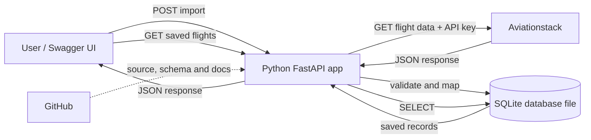

# Flight Data REST API — Project Plan

## Problem and proposed approach

Turn the meeting notes into a beginner-friendly Python project that consumes a free external flight-data API, stores selected results in SQLite, and exposes those stored results through its own REST API. The starter folder is empty. SQLite stores the database in a local file and does not require a separate database server or Workbench.

Use Python's built-in `sqlite3` module and store the database in a local file such as `data/flights.db`. Do not commit the database file to GitHub; commit the schema and setup instructions instead.

Use Aviationstack's free personal plan for an educational, non-commercial project. Its published plan currently advertises real-time flight data and 100 requests per month; it requires an API key. Keep upstream calls explicit and bounded: a manual `POST /api/v1/flight-imports` action fetches and saves results, while `GET /api/v1/flights` and `GET /api/v1/flights/{id}` read from SQLite. This avoids spending a provider request for every read and makes the data lifecycle easy to understand.

## Proposed project flow

## Concepts and boundaries

- **REST:** the app's HTTP interface; explain resources, URLs, methods, status codes, JSON, query parameters, and stateless requests using the project routes.
- **Two APIs:** Aviationstack is the upstream API the app consumes; the FastAPI service is the REST API the project builds for its users.
- **SQLite:** The app connects directly to a local database file. There is no separate database server or Workbench setup. The database can be inspected with the SQLite command-line tool or a SQLite-compatible viewer.
- **Git and GitHub:** Git records project changes locally; GitHub hosts the code and documentation remotely. The repo may include setup instructions, the SQLite schema, and `.env.example`, but must exclude API keys, real `.env` files, and database files.
- Keep the first version API-only; FastAPI's generated Swagger UI provides an interactive way to try endpoints, without a separate frontend.
- Model each import as stored flight data with an import timestamp, so a later import can preserve a new observation rather than silently erasing the prior one. Select fields from the provider response only after checking its current API documentation.
- Provider limits and data availability can change. Keep the import request limited to a small, documented sample, handle upstream errors explicitly, and avoid automated polling.

## Implementation todos

1. Confirm current Aviationstack endpoint, query filters, response shape, free-plan limits, and key handling; document the exact chosen sample request.
2. Define the app structure, SQLite schema, REST routes, data mapping, environment configuration, and error behavior.
3. Build the FastAPI service using `sqlite3`, including explicit import and stored-data retrieval endpoints.
4. Add focused tests for mapping, routes, validation, and upstream/database error paths using mocked external calls and temporary SQLite databases where appropriate.
5. Write step-by-step documentation: REST/API concepts, Python prerequisites, SQLite database file and inspection options, API-key setup, configuration, schema/import flow, endpoint examples, flowchart, Git/GitHub workflow, and troubleshooting.
6. Initialize a local Git repository, add safe ignore/config examples, validate the setup and tests, and explain how to create/connect the GitHub remote and push the project.

## Research references

- [Aviationstack pricing](https://aviationstack.com/pricing) — free plan, request quota, non-commercial use, and listed flight-data capabilities.
- [Aviationstack API documentation](https://docs.apilayer.com/aviationstack/docs/api-documentation) — endpoint and response details to confirm before implementation.
- [OpenSky REST API](https://openskynetwork.github.io/opensky-api/rest.html) — considered alternative for aircraft state/position data, which is different from flight schedule/status data.
