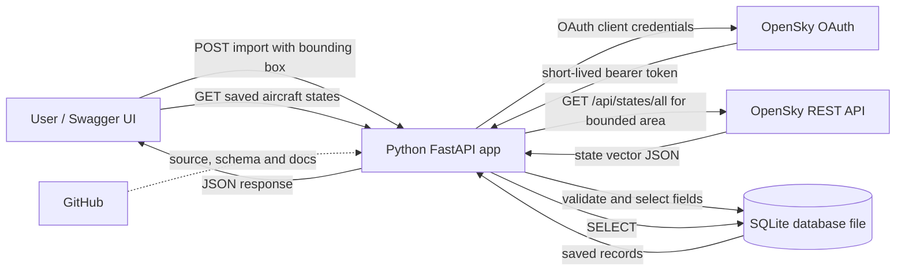

# Aircraft State REST API — Project Plan

## Problem and proposed approach

Build a beginner-friendly Python project that consumes live aircraft state data from the OpenSky Network REST API, stores selected state-vector observations in SQLite, and exposes those stored observations through its own REST API. OpenSky provides ADS-B-derived aircraft positions and tracking data; it does not provide commercial airline schedules or delays. SQLite stores the database in a local file and does not require a separate database server or Workbench.

Use Python's built-in `sqlite3` module and store the database in a local file such as `data/airzone.db`. Do not commit the database file or OpenSky client secrets to GitHub; commit the schema, setup instructions, and `.env.example` instead.

Keep upstream calls explicit and bounded: a manual `POST /api/v1/state-imports` action accepts a validated geographic bounding box, fetches the current state vectors in that area from OpenSky's `GET /api/states/all` endpoint, selects the agreed fields, and saves the observations with the snapshot time. `GET /api/v1/aircraft-states` and `GET /api/v1/aircraft-states/{id}` read saved observations from SQLite; they do not call OpenSky. This makes the data flow clear and avoids unnecessary upstream requests.

The OpenSky REST API uses OAuth 2.0 client credentials. The project will read the client ID and client secret from environment configuration, obtain a short-lived bearer token, and never expose or commit the credentials or token. Confirm current authentication requirements, request limits, and terms before implementation.

The standard state vector has 17 indexed fields (0–16); requesting extended data adds an optional `category` field. Store only the following subset, mapping nullable provider values safely:

- Core tracking fields: ICAO 24-bit address (`icao24`), callsign, origin country, last-contact timestamp, longitude, latitude, barometric altitude, on-ground flag, velocity, and true track/heading.
- Additional selected fields: vertical rate, geometric altitude, squawk, and position source.
- Record the provider snapshot time and local import time. Do not store the optional category or receiver sensor IDs in the initial version.

## Proposed project flow

## Concepts and boundaries

- **REST:** the app's HTTP interface; explain resources, URLs, methods, status codes, JSON, query parameters, and stateless requests using the project routes.
- **Two APIs:** OpenSky is the upstream REST API the app consumes; the FastAPI service is the REST API the project builds for its users.
- **Aircraft state vectors:** explain that the 17 standard fields are positional indexes in each returned array, some values may be null, and the project maps only selected fields into named SQLite columns. The optional extended category is out of scope initially.
- **SQLite:** The app connects directly to a local database file. There is no separate database server or Workbench setup. The database can be inspected with the SQLite command-line tool or a SQLite-compatible viewer.
- **OAuth credentials:** explain client credentials and short-lived bearer tokens at a high level. Keep the client secret in local environment configuration, not in source, logs, API responses, or GitHub.
- **Git and GitHub:** Git records project changes locally; GitHub hosts the code and documentation remotely. The repo may include setup instructions, the SQLite schema, and `.env.example`, but must exclude OpenSky secrets, real `.env` files, tokens, and database files.
- Keep the first version API-only; FastAPI's generated Swagger UI provides an interactive way to try endpoints, without a separate frontend.
- Model each import as a timestamped snapshot and each returned aircraft as an observation in that snapshot, so later imports preserve previous observations. Validate the bounding box coordinates and ordering before making an upstream request.
- Respect OpenSky request limits and terms. Require a geographic bounding box to bound the result set, make imports manual only, handle OAuth/upstream/database errors explicitly, and avoid automated polling.

## Implementation todos

1. Confirm OpenSky OAuth token acquisition, `/api/states/all` response shape and state-vector indexes, rate limits, geographic filtering, and terms; document a small bounding-box request.
2. Define the app structure, SQLite schema for timestamped snapshots and aircraft observations, REST routes, field mapping, environment configuration, and explicit error behavior.
3. Build the FastAPI service using `sqlite3`, including OAuth token handling, manual bounded state imports, and stored-observation retrieval endpoints.
4. Add focused tests for state-vector mapping (including null values), routes, bounding-box validation, OAuth/upstream/database error paths, and temporary SQLite databases, with external calls mocked.
5. Write step-by-step documentation: REST/API and state-vector concepts, Python prerequisites, OpenSky OAuth client setup, SQLite database file and inspection options, configuration, selected fields and import flow, endpoint examples, flowchart, Git/GitHub workflow, terms/limits, and troubleshooting.
6. Initialize a local Git repository, add safe ignore/config examples, validate the setup and tests, and explain how to create/connect the GitHub remote and push the project.

## Research references

- [OpenSky REST API documentation](https://openskynetwork.github.io/opensky-api/rest.html) — `/states/all`, geographic bounding-box parameters, state-vector response fields, and OAuth client-credentials authentication.
- [OpenSky API overview and terms](https://openskynetwork.github.io/opensky-api/) — scope of ADS-B-derived data, non-commercial/research focus, citation guidance, and terms reference.
- [OpenSky terms of use](https://opensky-network.org/about/terms-of-use) — review current data-use conditions before implementation or publication.
